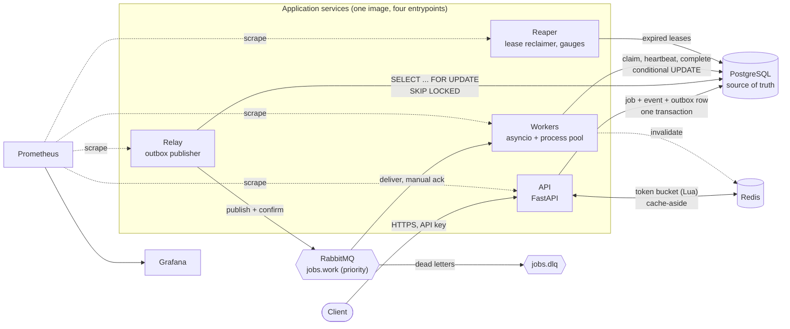
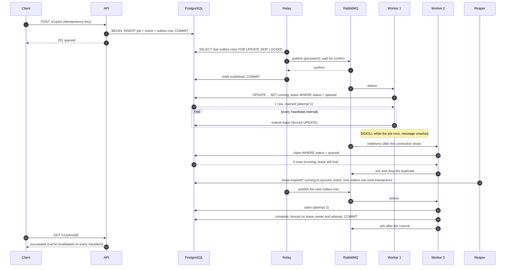
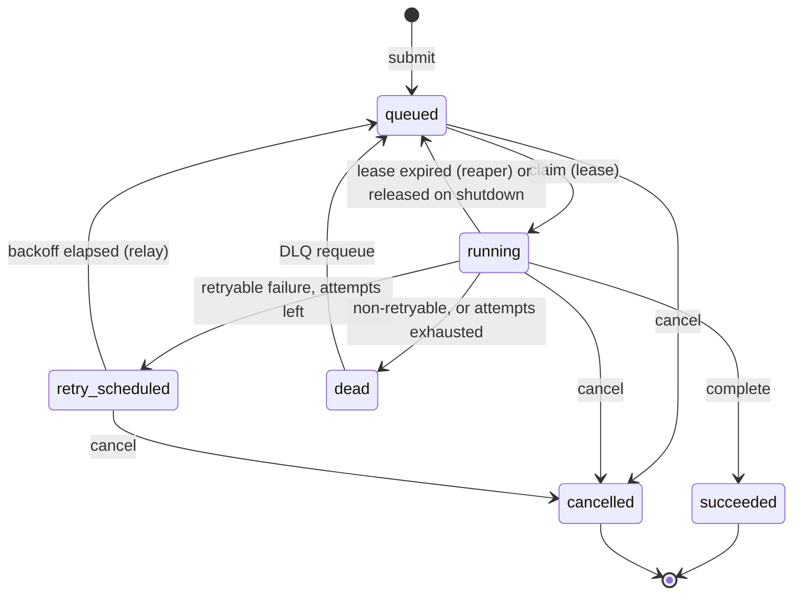
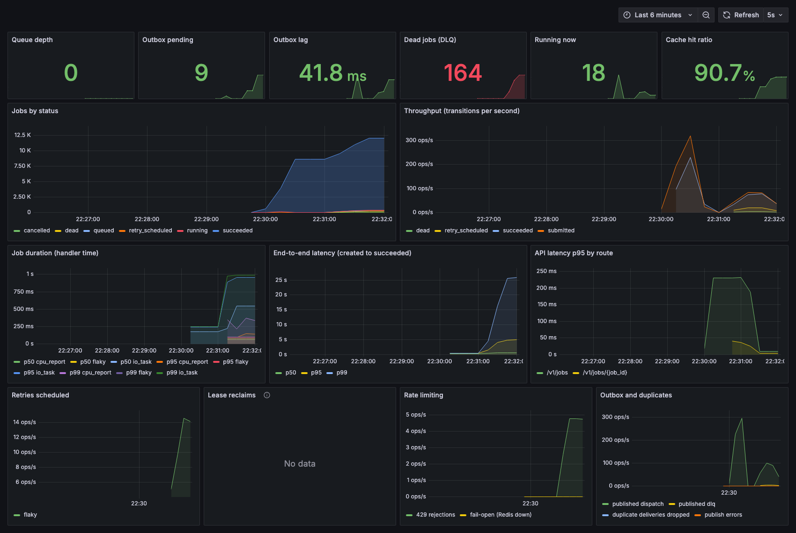

# Distributed Job Processing Platform

Submit long-running jobs through a REST API, process them asynchronously on a pool of workers, and track their status, with PostgreSQL as the source of truth, RabbitMQ for dispatch and dead letters, and Redis for caching and distributed rate limiting.

[](https://github.com/pranav1233/distributed-job-platform/actions/workflows/ci.yml)
[](https://www.python.org/downloads/)
[](LICENSE)

## Features

- **Job API** (FastAPI): submit, fetch, list with filters and cursor pagination, cancel, inspect and requeue the dead-letter queue. Idempotency keys, API key authentication (hashes only), Pydantic v2 validation, one error format, request ids propagated into every log line.
- **Transactional outbox**: a job, its audit event and its dispatch message are written in one database transaction. The API never talks to RabbitMQ, so a broker outage cannot fail a submit.
- **Concurrent relays**: the outbox publisher uses `SELECT ... FOR UPDATE SKIP LOCKED` and publisher confirms, so any number of relay instances can run without duplicates or losses.
- **Crash-safe workers**: at-least-once delivery, a conditional-UPDATE claim, leases with heartbeats, fenced state transitions, acknowledgement only after the database commit, per-job timeouts, cooperative cancellation (including for CPU-bound jobs in a process pool), graceful SIGTERM drain.
- **Failure handling**: exponential backoff with full jitter driven by PostgreSQL, retryable and non-retryable error classes, a reaper that reclaims expired leases, a dead-letter queue that can be inspected and requeued through the API.
- **Redis**: an atomic Lua token bucket per API key (fail-open), and cache-aside reads with TTLs by state, version-guarded invalidation and stampede protection.
- **Observability**: Prometheus metrics, structured JSON logs, and a provisioned Grafana dashboard.
- **Verified under failure**: integration tests against real PostgreSQL, RabbitMQ and Redis, and a chaos test that kills real processes while thousands of jobs run.
- **Deployable**: one Docker image with four entrypoints, a docker compose stack, Terraform for AWS (ECS Fargate, RDS, ElastiCache, Amazon MQ, ALB), GitHub Actions CI.

## Architecture



### Job lifecycle, including the outbox and a worker crash



## Job state machine



Every arrow is one conditional `UPDATE ... WHERE status = <expected>` in a transaction that also appends a row to `job_events`. A transition that is not in the diagram cannot be applied, and a test runs every (state, operation) pair against real PostgreSQL to prove it.

## Key design decisions and tradeoffs

### Transactional outbox

Publishing to a broker and committing to a database cannot be made atomic, so doing both from the request handler loses jobs (commit succeeds, publish fails) or creates phantom messages (publish succeeds, commit fails). Instead the API writes the job, an audit event and an `outbox` row in one transaction and returns. The relay turns outbox rows into messages afterwards.

- The relay selects due rows with `FOR UPDATE SKIP LOCKED`, publishes with publisher confirms and `mandatory=True`, then marks the rows published. Concurrent relays take disjoint batches. A crash after publish but before the commit republishes the batch, which is the at-least-once edge the worker absorbs.
- Rows with a future `available_at` are not published until due, which is also how `delay_seconds` and retry backoff are implemented.
- Cost: an extra hop (about 37 ms median from creation to the start of execution in the steady-state benchmark below) and a table to prune. Published rows are deleted by the reaper after an hour.
- At larger scale: replace polling with change data capture (logical replication or Debezium) or `LISTEN/NOTIFY`, and partition the outbox table by time.

### At-least-once delivery plus idempotency, not "exactly-once"

No broker and database pair can deliver exactly once across a crash. The platform therefore accepts duplicates and makes them harmless:

- the claim is a conditional `UPDATE` (`queued` to `running`), so a duplicate delivery for a running, finished or cancelled job fails the claim and is acked and dropped;
- every later transition is fenced on `(lease_owner, attempts)`, so a worker that lost its lease cannot overwrite the new owner's result;
- handlers are idempotent. The example `side_effect` job writes `INSERT ... ON CONFLICT (job_id) DO UPDATE SET executions = executions + 1`: the effect exists once, and the counter shows how many times the handler really ran. The chaos test checks this table.

The worker acknowledges only after the database transition commits. The effect is exactly-once outcomes for state and for effects written with the same idempotency discipline. Effects on third-party systems need the provider's own idempotency keys, which handlers can derive from the job id.

### Postgres-driven backoff

A failed job moves to `retry_scheduled` with `available_at = now() + jitter` and a future-dated outbox row. Delays are `uniform(0, min(cap, base * 2^(attempt-1)))` (full jitter), which spreads retries after a shared dependency recovers. RabbitMQ per-message TTL was rejected because TTLs only expire at the head of a queue, so a long delay blocks shorter ones behind it. With Postgres owning the clock, backoff survives broker restarts, is visible in SQL, and can be cancelled. At larger scale a dedicated timer service (SQS delay queues, a Redis sorted set, or a workflow engine) would take over once the due-row scan becomes the bottleneck.

### Leases and heartbeats

A claim sets `lease_owner` and `lease_expires_at` (database clock). The worker extends the lease on a fixed interval with a fenced `UPDATE`. A crashed worker stops heartbeating, the lease expires, and the reaper returns the job to `queued` with an audit event and a new outbox row, so recovery never depends on the broker redelivering the original message. A heartbeat that affects zero rows tells a running worker that the lease is gone (reclaimed, or cancelled through the API) and it cancels the handler. A database `CHECK` guarantees a lease exists if and only if the job is `running`. Crashed attempts count against `max_attempts`, so a job that kills its worker cannot loop forever. At larger scale heartbeats can be batched per worker into one statement, or moved to a lease store such as etcd.

### Role of each datastore

| Store | Holds | Why it was chosen | Failure impact |
| --- | --- | --- | --- |
| PostgreSQL | Jobs, audit events, outbox, API key hashes, side-effect table | Transactions make the state machine, the outbox and the audit log atomic. It is the only source of truth. | Writes stop. Nothing already committed is lost. |
| RabbitMQ | Dispatch intent, priority ordering, dead-letter exchange | Low-latency push delivery with prefetch, priorities, manual acks and DLX. Holds no state that cannot be rebuilt from Postgres. | New work waits in the outbox. In-flight work continues. |
| Redis | Token buckets, job read cache, stampede locks | Atomic Lua scripts and sub-millisecond reads. Everything in it is disposable. | Rate limiting fails open, reads fall back to Postgres. |

At larger scale: read replicas and PgBouncer in front of Postgres, time partitioning for `jobs`, `job_events` and `outbox`; RabbitMQ quorum queues in a cluster, or Kafka, SQS or Pulsar when throughput outgrows one broker; Redis Cluster, or rate limiting at the edge (API gateway or WAF).

## Failure handling

| Failure | What happens | How it is covered |
| --- | --- | --- |
| Worker dies mid-job (SIGKILL, OOM, node loss) | The row stays `running`, heartbeats stop, the lease expires. The reaper moves it to `queued` (or `dead` when attempts are exhausted) with an audit event and a new outbox row; the relay republishes and another worker claims it with `attempts + 1`. The original unacked message is requeued by the broker, fails the claim while the lease is live, and is dropped. A worker that returns late is fenced out. | Integration tests for reaper recovery, fencing and heartbeats; chaos test with repeated SIGKILLs |
| RabbitMQ down or restarted | Submits are unaffected because the API never talks to the broker. Outbox rows stay pending and `outbox_lag_seconds` rises. The relay fails the confirm, backs off up to 5 s and resumes. Workers and the relay reconnect automatically. Durable queues and persistent messages survive a restart. | Unconfirmed-publish test; chaos test restarts the broker |
| Redis down | The limiter admits requests and increments `rate_limit_fail_open_total`. Cache reads fall through to Postgres and `cache_errors_total` rises. `/readyz` stays 200 and reports Redis as degraded. Nothing of record lives in Redis. | Fail-open integration tests; chaos test restarts Redis |
| Postgres restart or failover | API requests that touch the database fail with 500 until it returns, and clients retry with the same `Idempotency-Key`. Workers retry a failed completion four times with backoff, then leave the job `running` and nack the delivery; the lease expires and the reaper recovers it. Relay and reaper loops back off and resume. Stale pooled connections are discarded (`pool_pre_ping`). | Chaos test restarts PostgreSQL mid-run |
| Relay crashes | Committed outbox rows stay pending and other relays keep draining. A crash between publish and commit republishes that batch, and the duplicate deliveries fail their claim. | Two-relay test (exactly once per row), chaos test kills the relay |
| Poison job | An unparseable message is rejected without requeue and dead-letters through the queue DLX, so the worker stays healthy. A handler that always fails retries with backoff until `max_attempts`; a non-retryable error goes straight to `dead`; a job that crashes its worker burns an attempt per crash and ends in `dead`. Dead jobs appear in `GET /v1/dlq` and can be requeued. | Poison, non-retryable, exhaustion and requeue tests |
| Duplicate delivery | The claim fails and the delivery is acked and dropped. | Duplicate-delivery test (three deliveries, one execution) |
| API or reaper process dies | Both are stateless. The load balancer routes around the API, and a restarted reaper resumes scanning leases. | Chaos test kills each |

## Quickstart

Requirements: Docker with Compose v2.

```bash
git clone https://github.com/pranav1233/distributed-job-platform.git
cd distributed-job-platform
docker compose up -d --build --wait      # same as: make up
```

This starts PostgreSQL, Redis, RabbitMQ, a one-shot migration, the API, two workers, the relay, the reaper, Prometheus and Grafana, all with health checks.

| URL | What |
| --- | --- |
| http://localhost:8000/docs | API documentation (OpenAPI) |
| http://localhost:3000 | Grafana dashboard (anonymous viewer, admin password `admin` for local use only) |
| http://localhost:9090 | Prometheus |
| http://localhost:15672 | RabbitMQ management (`guest` / `guest`) |

Create an API key. The raw key is printed once and only its hash is stored.

```bash
KEY=$(docker compose run --rm --no-deps -T api python -m jobplatform.cli create-api-key --owner demo 2>/dev/null | tail -n1)
AUTH="Authorization: Bearer $KEY"
```

Submit a job (the `Idempotency-Key` makes retries safe):

```bash
curl -s -X POST localhost:8000/v1/jobs -H "$AUTH" -H 'Content-Type: application/json' \
  -H 'Idempotency-Key: order-42' \
  -d '{"type":"io_task","payload":{"duration_ms":2000},"priority":5}'
# {"id":"0b0c...","status":"queued","attempts":0,...}
```

Poll it, list jobs, read the audit trail:

```bash
JOB=<id from the response>
curl -s localhost:8000/v1/jobs/$JOB -H "$AUTH"
curl -s "localhost:8000/v1/jobs?status=succeeded&limit=10" -H "$AUTH"
curl -s localhost:8000/v1/jobs/$JOB/events -H "$AUTH"
```

Cancel a job that has not run yet:

```bash
JOB=$(curl -s -X POST localhost:8000/v1/jobs -H "$AUTH" -H 'Content-Type: application/json' \
  -d '{"type":"io_task","delay_seconds":300}' | python3 -c 'import sys,json; print(json.load(sys.stdin)["id"])')
curl -s -X POST localhost:8000/v1/jobs/$JOB/cancel -H "$AUTH"
```

Send a job that fails permanently, find it in the dead-letter queue, and requeue it:

```bash
DEAD=$(curl -s -X POST localhost:8000/v1/jobs -H "$AUTH" -H 'Content-Type: application/json' \
  -d '{"type":"flaky","payload":{"fail_times":50,"error":"fatal"}}' | python3 -c 'import sys,json; print(json.load(sys.stdin)["id"])')
sleep 2
curl -s localhost:8000/v1/dlq -H "$AUTH"
curl -s -X POST localhost:8000/v1/dlq/$DEAD/requeue -H "$AUTH"
```

Run the automated version of all of the above with `make smoke`. Stop everything with `make down`.

### Job types

| Type | Payload | Behaviour |
| --- | --- | --- |
| `io_task` | `duration_ms` | Simulated long-running I/O call (asyncio sleep) |
| `cpu_report` | `rows`, `seed` | CPU-bound aggregation in a process pool; deterministic checksum; cancellable between chunks |
| `flaky` | `fail_times`, `error` (`retryable` or `fatal`), `duration_ms` | Fails the first `fail_times` attempts, then succeeds. Exercises retries and the DLQ |
| `side_effect` | `effect`, `duration_ms` | Records one idempotent row in `job_effects` per job, however many times the handler runs |

Handlers are registered in `src/jobplatform/worker/registry.py` with their payload schema, attempt budget, timeout, backoff parameters and non-retryable exception classes.

### Configuration

All settings are environment variables (see `.env.example`). The ones that matter most:

| Variable | Default | Meaning |
| --- | --- | --- |
| `WORKER_CONCURRENCY` / `WORKER_PREFETCH` | 16 / 32 | Jobs per worker process, and unacked messages per consumer |
| `WORKER_CPU_PROCESSES` | 2 | Process pool size for CPU-bound jobs |
| `LEASE_SECONDS` / `HEARTBEAT_INTERVAL_SECONDS` | 30 / 10 | Lease length and heartbeat period |
| `SHUTDOWN_GRACE_SECONDS` | 20 | Time to drain in-flight jobs on SIGTERM before releasing leases |
| `RETRY_BASE_DELAY_SECONDS` / `RETRY_MAX_DELAY_SECONDS` | 2 / 300 | Backoff base and cap |
| `RELAY_POLL_INTERVAL_SECONDS` / `RELAY_BATCH_SIZE` | 0.05 / 200 | Outbox polling period and batch size |
| `DEFAULT_RATE_LIMIT_CAPACITY` / `..._REFILL_PER_SEC` | 100 / 50 | Token bucket for keys without their own limits |
| `CACHE_TTL_ACTIVE_SECONDS` / `CACHE_TTL_TERMINAL_SECONDS` | 3 / 300 | Read cache TTLs by job state |
| `OUTBOX_RETENTION_SECONDS` | 3600 | How long published outbox rows are kept before the reaper deletes them |

The values above are the application defaults. `docker-compose.yml` overrides some of them for the local stack (worker concurrency 32, prefetch 48, two worker replicas) and reads further overrides from the environment or a `.env` file.

## API reference

All `/v1` endpoints require `Authorization: Bearer <key>` (or `X-API-Key`). Interactive documentation is served at `/docs`.

| Method and path | Purpose | Notes |
| --- | --- | --- |
| `POST /v1/jobs` | Submit a job | Body: `type`, `payload`, `priority` (0 to 9, default 5), `max_attempts` (1 to 20), `delay_seconds`. Header `Idempotency-Key`. `201` on create, `200` with `Idempotent-Replayed: true` on replay, `409` if the key was used with a different body, `422` for an unknown type or invalid payload |
| `GET /v1/jobs/{id}` | Fetch a job | Cached in Redis. Other owners' jobs return `404` |
| `GET /v1/jobs` | List jobs | Filters `status`, `type`; `limit` (1 to 200), opaque `cursor`; newest first |
| `GET /v1/jobs/{id}/events` | Audit trail | Every state transition with actor, reason and attempt |
| `POST /v1/jobs/{id}/cancel` | Cancel | From `queued`, `retry_scheduled` or `running`. `409` if already finished |
| `GET /v1/dlq` | List dead jobs | Same pagination as `GET /v1/jobs` |
| `POST /v1/dlq/{id}/requeue` | Requeue a dead job | Resets attempts, `409` if the job is not dead |
| `GET /healthz` | Liveness | No dependencies touched |
| `GET /readyz` | Readiness | Requires Postgres; Redis reported as `ok` or `degraded`; RabbitMQ is not checked because the API never uses it |
| `GET /metrics` | Prometheus metrics | |

Every response carries `X-Request-ID` (an inbound value is honoured) and, on authenticated routes, `X-RateLimit-Limit`, `X-RateLimit-Remaining` and `X-RateLimit-Reset`. A rejected request returns `429` with `Retry-After`. Errors share one envelope:

```json
{"error": {"code": "invalid_payload", "message": "payload does not match the schema for 'io_task'",
           "request_id": "6f1c0e3a0c9f4d4e8a53d3f5a4b1c2d0", "details": [...]}}
```

## Observability

Each service exposes Prometheus metrics (API on `:8000/metrics`, worker `:9101`, relay `:9102`, reaper `:9103`).

| Area | Metrics |
| --- | --- |
| Jobs | `jobs_by_status`, `jobs_transitions_total{from_status,to_status}`, `job_duration_seconds{type,outcome}`, `job_end_to_end_seconds{type}`, `job_retries_total{type}` |
| Queue and DLQ | `queue_depth`, `dlq_size{source}` |
| Outbox | `outbox_pending`, `outbox_lag_seconds`, `outbox_published_total{kind}`, `outbox_skipped_total{reason}`, `outbox_publish_errors_total` |
| Workers | `worker_inflight_jobs`, `worker_duplicate_deliveries_total`, `worker_poison_messages_total`, `worker_heartbeat_failures_total`, `worker_lease_lost_total` |
| Reaper | `lease_reclaims_total{outcome}` |
| API | `http_requests_total`, `http_request_duration_seconds`, `rate_limit_rejections_total`, `rate_limit_fail_open_total`, `cache_hits_total`, `cache_misses_total`, `cache_errors_total` |

Cache hit ratio is `rate(cache_hits_total) / (rate(cache_hits_total) + rate(cache_misses_total))`.

Logs are JSON (structlog). API logs carry `request_id` and `owner`; worker logs carry `job_id`, `owner`, `job_type`, `attempt` and `worker_id`.

`docker compose up` provisions Prometheus (with DNS discovery of every worker replica) and a Grafana dashboard from `deploy/grafana/dashboards/jobplatform.json`: queue depth, jobs by status, throughput, handler and end-to-end latency, API latency by route, retries, lease reclaims, rate limiting, outbox lag, dead jobs and cache hit ratio.



## Benchmarks and chaos results

All figures below come from real runs of `make bench` and `make chaos` on one machine, and are copied from `docs/BENCHMARKS.md` and `docs/CHAOS_RESULTS.md` (raw JSON is written to `bench-out/`). They describe a laptop running everything at once, not a production deployment.

### Environment

- Machine: Apple M4, 10 logical CPUs, 16 GB RAM, macOS-27.2.1-arm64-arm-64bit
- Docker Desktop 29.9.3, VM limits 10 CPUs and 7.7 GB
- PostgreSQL, Redis, RabbitMQ, the API (a single uvicorn process), workers, relay, reaper, Prometheus, Grafana and the load generator all share this one machine, and the Docker VM is the limit for the containers. Dedicated hosts would give different numbers.
- Defaults for durability were left on: `fsync` and `synchronous_commit` are enabled, messages are persistent, publishes wait for broker confirms.

### Load test

```bash
make bench    # uv run python scripts/load_test.py --workers 1 2 4 --write-report
```

The stack is rebuilt from scratch for each worker count. Each worker process runs 32 jobs concurrently (prefetch 48), logging is at `WARNING`, and the job type is `io_task` sleeping 200 ms, so one worker process can complete at most 160 jobs/s.

1. **Burst**: 8000 jobs submitted over 64 concurrent HTTP connections from 4 load generator processes (a single Python process would itself cap at around a thousand requests per second), then the backlog drains. *Enqueue* is jobs divided by submission wall time. *Sustained processed* counts completions between the 10th and 90th percentile of completion times, which excludes ramp-up and tail.
2. **Steady state**: open-loop 20 jobs/s for 15 s, so the queue stays empty and end-to-end latency (`finished_at - created_at`, both from PostgreSQL) shows platform overhead plus the 200 ms of handler time.
3. **Reads**: `GET /v1/jobs/{id}` for 2000 distinct jobs, first pass cold (cache miss), second pass warm (cache hit).

| Workers | Enqueue (jobs/s) | POST p50 / p95 / p99 (ms) | Sustained processed (jobs/s) | Scaling vs 1 worker |
| ---: | ---: | --- | ---: | ---: |
| 1 | 677.4 | 88.03 / 127.1 / 142.96 | 129.0 | 1.00x |
| 2 | 649.6 | 93.54 / 127.95 / 163.97 | 282.5 | 2.19x |
| 4 | 557.4 | 107.51 / 147.08 / 196.64 | 563.5 | 4.37x |

| Workers | Steady-state end-to-end p50 / p95 / p99 (ms) | Queue wait p50 / p95 (ms) |
| ---: | --- | --- |
| 1 | 244.29 / 272.13 / 280.9 | 37.28 / 63.61 |
| 2 | 243.37 / 270.14 / 278.73 | 36.38 / 62.7 |
| 4 | 244.44 / 270.07 / 274.07 | 36.6 / 63.04 |

| Workers | GET, cache miss p50 / p95 / p99 (ms) | req/s | GET, cache hit p50 / p95 / p99 (ms) | req/s |
| ---: | --- | ---: | --- | ---: |
| 1 | 51.48 / 73.62 / 133.75 | 1114.3 | 18.55 / 38.49 / 44.24 | 2954.8 |
| 2 | 53.59 / 75.25 / 162.66 | 1058.7 | 19.33 / 60.1 / 106.72 | 2411.4 |
| 4 | 54.03 / 82.89 / 147.38 | 1082.6 | 18.84 / 35.54 / 97.59 | 2818.8 |

The full report, including latency under backlog and per-container CPU during the burst, is in [docs/BENCHMARKS.md](docs/BENCHMARKS.md).

### Chaos test

```bash
make chaos    # uv run python scripts/chaos_test.py --jobs 3000 --workers 4 --submit-seconds 45.0 --seed 7
```

The script rebuilds the compose stack with short leases (`LEASE_SECONDS=6`, heartbeat 2 s, reaper every 1 s), 4 workers running 16 jobs each, and submits 3000 jobs (2429 `side_effect`, the rest `flaky` and `io_task`, each with its own `Idempotency-Key`) over 45 seconds. While jobs run it injects:

- 13 random worker SIGKILLs, each followed by a restart 1 to 3 seconds later;
- one restart of PostgreSQL, Redis and RabbitMQ each;
- one SIGKILL each of the API, the relay and the reaper.

Then it waits for the system to settle and checks the database directly:

| Check | Result |
| --- | --- |
| zero lost jobs | PASS: 3000 acknowledged by the API, 3000 in Postgres, 0 missing, 0 unexpected |
| every job reached a terminal state | PASS: {'succeeded': 3000} |
| no job exhausted its retries | PASS: succeeded=3000 dead=0 |
| exactly one side effect per side_effect job | PASS: 2429 side_effect jobs, 2429 effect rows (2429 distinct), 0 jobs without an effect, 0 orphans |
| audit trails are unbroken, one `succeeded` event per job | PASS: 0 broken transitions, 0 jobs without exactly one succeeded event |
| outbox fully drained | PASS: 0 rows pending |
| every submit eventually acknowledged | PASS: 3000/3000 acknowledged, 242 client retries, 0 idempotent replays |

Overall: **PASS**, in 86.2 s from the first submit to the last terminal job.

Recovery activity during that run: 177 leases reclaimed by the reaper, 438 handler retries scheduled, 443 jobs that needed more than one attempt (3615 attempts in total for 3000 jobs). The `side_effect` handler executed 2583 times for 2429 jobs; 139 jobs ran more than once (at most 4 times) and each still produced exactly one effect row. Clients retried 242 requests while the API, PostgreSQL and Redis were down. Full output: [docs/CHAOS_RESULTS.md](docs/CHAOS_RESULTS.md).

## Testing

Requirements: Python 3.12 with [uv](https://docs.astral.sh/uv/), and Docker for the integration tests and the chaos and load tests.

```bash
uv sync                 # install locked dependencies
make lint               # ruff check, ruff format --check, mypy (strict)
make unit               # unit tests, no containers needed
make test               # unit + integration with coverage (starts PostgreSQL, Redis, RabbitMQ via testcontainers)
make chaos              # chaos test against the docker compose stack
make bench              # load test at 1, 2 and 4 workers, writes docs/BENCHMARKS.md
make tf-validate        # terraform fmt -check and validate
```

Integration tests start throwaway PostgreSQL 16, Redis 7 and RabbitMQ 3.13 containers. To use existing services instead (as CI does with service containers), set `TEST_DATABASE_URL`, `TEST_REDIS_URL` and `TEST_RABBITMQ_URL`.

What is covered:

- **Unit**: the state transition table (all 36 source and target pairs, plus random walks), backoff math with property-based tests, the Lua token bucket (run by an in-process Redis), cursor encoding, request fingerprints, key hashing, payload schemas, the CPU handler.
- **Integration (real PostgreSQL, Redis and RabbitMQ)**: submit, process, succeed; retry with backoff to success; exhaust retries, DLQ, requeue; non-retryable errors; timeouts; cancel in every cancellable state, including a running CPU-bound job; idempotency keys, including 25 concurrent requests with one key; 429 rate limiting and header values; a burst that must admit exactly the bucket capacity; fail-open with Redis down; cache hits, invalidation on every transition, the stale-fill race and stampede protection; two concurrent relays publishing 600 rows exactly once each; broker failures leaving rows pending; message priority; job and outbox atomicity; crash recovery by the reaper; lease fencing; duplicate deliveries; poison messages; graceful shutdown release; heartbeats keeping a long job alive; every (state, operation) pair of the state machine against the database; the append-only audit table.
- **Chaos** (`scripts/chaos_test.py`): see the results below.

## AWS deployment

`infra/` contains Terraform (flat layout, no modules) that provisions:

- a VPC with public subnets for the load balancer and private subnets for everything else, one NAT gateway;
- an ECR repository with scan on push and a lifecycle policy;
- ECS Fargate services for `api` (behind the ALB), `worker` (CPU target-tracking autoscaling), `relay` and `reaper`, all from the same image, plus a one-off migration task definition;
- RDS PostgreSQL 16, ElastiCache Redis 7 (TLS), Amazon MQ for RabbitMQ 3.13;
- an Application Load Balancer with an optional HTTPS listener, and a rule that keeps `/metrics` off the public endpoint;
- Secrets Manager entries holding the connection strings, injected as ECS secrets so no credential appears in a task definition;
- CloudWatch log groups and alarms for ALB errors and latency, ECS, RDS, Redis and RabbitMQ health, jobs entering `dead`, and bursts of lease reclaims.

`make tf-validate` runs `terraform fmt -check` and `terraform validate`. Step-by-step instructions, cost notes and teardown are in [docs/DEPLOY.md](docs/DEPLOY.md). Design reasoning is in [docs/DESIGN.md](docs/DESIGN.md).

## Project structure

```
.
├── src/jobplatform/
│   ├── api/              FastAPI app, routes (jobs, dlq, health), auth and rate limit dependency, error envelope, middleware
│   ├── cache/            Redis cache-aside with version-guarded invalidation and stampede lock
│   ├── ratelimit/        Lua token bucket
│   ├── domain/           State machine table, backoff, error classes
│   ├── db/               SQLAlchemy models and session factory
│   ├── repo/             Conditional-UPDATE transitions, outbox queries, API keys
│   ├── messaging/        RabbitMQ topology and confirmed publisher
│   ├── relay/            Transactional outbox relay
│   ├── worker/           Consumer, leases and heartbeats, CPU process pool, job registry and handlers
│   ├── reaper/           Lease reclaimer, outbox pruning, platform gauges
│   ├── service.py        Transaction boundaries and post-commit hooks
│   ├── metrics.py        Prometheus metric definitions
│   ├── config.py         Settings from environment variables
│   └── cli.py            create-api-key
├── migrations/           Alembic migrations
├── tests/
│   ├── unit/
│   └── integration/      Real PostgreSQL, Redis and RabbitMQ
├── scripts/              chaos_test.py, load_test.py, smoke.sh
├── deploy/               Prometheus config, Grafana provisioning and dashboard
├── infra/                Terraform for AWS
├── docs/                 DESIGN.md, DEPLOY.md, BENCHMARKS.md, CHAOS_RESULTS.md
├── .github/workflows/    CI
├── Dockerfile            Multi-stage, non-root, one image for all four services
├── docker-compose.yml
└── Makefile
```

## License

MIT, see [LICENSE](LICENSE).
